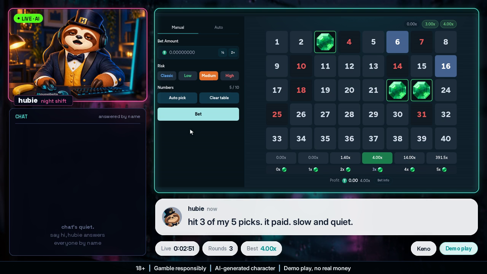
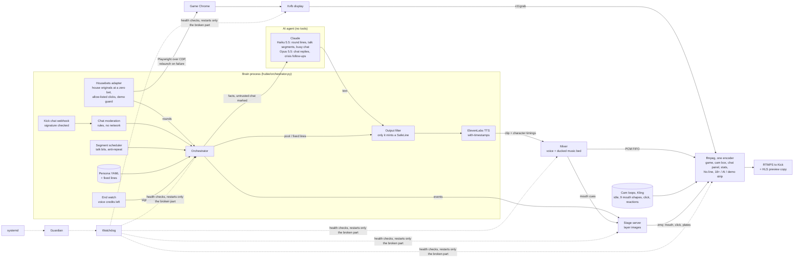

# Hubie, live 24/7

An unattended AI streamer for the Housebets "Hubie, live 24/7" contest. Hubie, the Housebets sloth, sits at his desk
in a cam box, plays Housebets house originals (dice, limbo, plinko, mines, keno, blackjack, Hubie's Road) at a zero
bet, says a line on every round, answers every chat message by name, changes segments so it never loops, and
restarts anything that breaks. One CPU-only Linux box runs all of it with no person at the controls.



## Final run

| | |
|---|---|
| On air | 2026-11-09 08:03:32 UTC to 2026-11-11 03:30:32 UTC, **about 43.5 hours** on Kick, one continuous run |
| Rounds played and commented | 5,481 |
| Chat messages answered by name | 45 |
| Human input after start | none: it signed off by itself when the voice budget ran out (ElevenLabs characters) |
| Claude calls | 3,552 Haiku 5.5 (2,277 round lines, 1,275 talk-segment lines), 26 Opus 5.5 (chat replies) |
| Voice | about 124,000 ElevenLabs characters |

- **Setup guide (one page):** [docs/SETUP.md](docs/SETUP.md)
- **Stack (models, services, tools):** [STACK.md](STACK.md)
- **Agents and tools:** the diagram below

## Agents and tools

There is one AI agent: Claude, writing Hubie's lines. It has no tools and cannot act on anything. It gets the facts
of the moment (round result, chat message, segment) and returns text. Everything around it is deterministic code,
on purpose: the parts that keep the show on air, play the games and guard safety must not be able to make things up.



## Quick start (free, offline)

```bash
# Needs: Python 3.10+, ffmpeg with libx264 + drawtext + zmq, Xvfb (full list: docs/SETUP.md)
python3 -m venv .venv && .venv/bin/pip install -r requirements.txt
cp .env.example .env              # defaults are free: mock brain, local voice, fake chat, file output
.venv/bin/python -m hubie run     # guardian -> watchdog -> everything. Ctrl-C stops all of it
.venv/bin/python -m hubie status  # live state of each part
.venv/bin/python -m hubie report  # every failure and how long recovery took
```

Talk to him in text, no stream needed: `tools/chat_with_hubie.py` (real model with `ANTHROPIC_API_KEY`
set, or `--mock` for free). It runs the same moderation, brain and filter as the stream.

Tests: `pytest -m "not chaos"` (under a minute, no browser) and `pytest -m chaos` (real stack, kills
each part, about 15 minutes). No test spends money or contacts any game, chat or LLM service.

The rest of this page is engineering notes, written as the show was built. Some sections describe the slot
games and earlier looks; the contest run used house originals only (`HUBIE_HB_GAMES=none`) and the `mix` look.

## Picture

`HUBIE_SCENE=ffmpeg` draws the picture in one ffmpeg process with no browser. The default `HUBIE_LAYOUT=desk`
(`hubie/stage/desk.py`): the game takes the left 69% (880x496, `HUBIE_SCENE_BG=x11` scales the full 1280x720 game
display into it, `HUBIE_GAME_GRAB=x,y,w,h` picks another region; `HUBIE_SCENE_BG=image` with `HUBIE_SCENE_BG_IMAGE`
is a still for tests), big two-line subtitles go under the game. The right column (layout 1, owner's pick 2026-11-07),
top to bottom: Hubie's desk cam (376x250, rounded, teal border, one LIVE · AI tag), the live **KICK CHAT** list and
the stats block (TIME LIVE, SPINS, BEST MULTI, DEMO BALANCE in a 2x2 grid, then GAME and NOW lines under a divider).
The safety strip is burned in as before.

**Chat list.** Until the first message it shows a dim "chat's quiet. say hi, hubie answers everyone by name". Every incoming message that moderation lets through is added at the bottom; older ones scroll up and
drop off (only whole messages are drawn, never one cut under the header). Name colours come from an md5 of the
username (stable across restarts, eight colours readable on the navy, none gold or header teal); text wraps, at most
three lines a message. His spoken replies to chat are added as gold rows ("Hubie: ...") when the clip starts
playing (the `speak` event's `reply_to`). Not shown: anything moderation blocks, crisis / support / age / chasing
messages and his replies to them, injection, fake authority, deposit or advice asks, cruelty and rage (shown: ordinary
chat, pick, beg, AI questions, goodnights). A message the model flags as a crisis after it was shown is taken back
off (`chat_hide`). The layer (`chat.png`, read 5 times a second) is redrawn only when the chat changes, and the
last 40 rows live in `session.json`, so a stage restart keeps the list.

**Game area, strip, label (2026-11-07).** While the game isn't running (a game switch, a recovery, startup, demo
refused) a "switching game" card covers the whole game box: Housebets navy, Hubie standing, the next game's name, a
sliding teal bar. The orchestrator sends `game_state` events (`loading` / `recovering` / `offline` / `ready`); the
card goes only on `ready`, which needs the adapter's `screen_ready()` (housebets: a game loaded in fun mode and, with
the top bar on, the bar checked). The encoder graph starts with the card on (`overlay@card`), so a fresh encoder never
shows a site page. The band under the game has the subtitles (plate shown only while he talks) above a "last spins"
strip: the last 6 rounds, newest first, game short name, multiplier (red 0x, grey under 1x, teal win, gold 10x+),
gold BUY / teal FS tags. The play segment's label rotates through Hubie names ("spinning slowly", "slots, at sloth
speed", at night "late night spins"...); the panel never prints "NOW Now playing". Image layers are re-read a few
times a second and land up to ~2 s late; the card keeps a generic "picking the next game" image ready so that lag
never shows the last game's name. `tools/scene_demo.py OUT.mp4 --v5` records all of it (`shots/scene_v5_fixes.mp4`).

**Housebets top bar** (`HUBIE_HB_TOPBAR=1`). The site's own header (logo, In Game, Wallet, prize) stays above the
game so viewers see it's Housebets: the game iframe sits under the 80 px header at 16:9 (1138x640 at x=71 in the
1280x720 window), the side margins get the site's navy, and the whole window is still scaled into the game box with
no distortion (no `HUBIE_GAME_GRAB` change needed). Every game coordinate (spin, intro, buy clicks, OCR boxes) is
measured at 1280x720 and mapped through `GameView` (live 2026-11-07: spins register, layout as planned). The header
shows the account's real balance, in a game too (live it never said "In Game"), so an init script on every site page
covers the pill around any amount left of the Wallet button with a navy "DEMO PLAY" patch from the page's first frame
(re-placed on every DOM change and animation frame). After each load and each round the adapter checks the bar: no
amount left of Wallet, or the patch proven over it (`PATCH_OK_JS`), else `screen_ready()` is false and the card stays
up. `tools/housebets/hb_spin.py --topbar` prints the check and saves a screenshot. `HUBIE_HB_TOPBAR=0` goes back to
the game filling the window.

**Browsing to a game** (`HUBIE_HB_BROWSE=1`, owner's pick 2026-11-07). A game switch opens the site's slots page,
scrolls with the mouse wheel (1-2 s pauses), hovers one or two other tiles, scrolls back to the game's tile, hovers
it and clicks it, then hovers and clicks Try fun mode: about 10 s before the game's own load. Xvfb draws no pointer,
so a drawn arrow follows the real mouse events. The only new click is the target's tile, by its exact `/games/<slug>`
link from our own game list (`assert_tile_clickable`), and only if `elementFromPoint` at the click point is inside
that link; other tiles are hover only, the mouse never goes into the header (its balance menu opens on hover). If the
tile isn't on screen after a look around, the game's name is typed into the page's own search (focused by script, no
click). Not found within ~22 s, or anything odd: the old direct load with the card. The stage shows the page only while
`PATCH_OK_JS` proves the balance patch is in place (`screen_state()` browsing / picked, else the card). He says a
start line that doesn't name the game (`browse_start`), then the pick once the pointer is on the tile
(`browse_pick`), `browse_aside` if it runs long. Live 2026-11-07 (`hb_spin.py --browse --topbar --video`,
`shots/browse_test.mp4`): Gates of Olympus 1000 and Sweet Bonanza 1000 picked and loaded, 594 recorded header frames
OCR'd: the balance never showed (DEMO PLAY or the site's own "Loading..."), real wallet unchanged.

**Dead air watchdog.** `HUBIE_WD_DEAD_AIR` is now 30 s (was 150; preview 30): every planned wait has words now. The
brain's heartbeat carries what it is blocked on (`doing`, `doing_since`), and a brain restart logs it (supervisor log
and `brain_last` in the incident). The 154 s stall on 2026-11-07 09:58-10:01 was a demo bonus buy on Gates of Olympus
1000: the bought feature round ran over two minutes with nothing said; long rounds now get `wait_round` words after
18 s of silence.

**Lip-sync.** `assets/cam_visemes/mouth_0..8.mp4` are the idle loop with each mouth shape (rest, slight, half, open,
wide, round, ee, f/v, small round) built by `tools/lipsync/build_visemes.py`: his own smile line is inpainted away on
every frame first, then each shape, cut along its own outline from his Kling talking frames, is lined up on the smile's
corners and feathered in. Rest is the idle loop untouched (his closed smile), so there is never a second mouth. All of
them decode in step; `streamselect` picks one per frame and the stage tells it which over ffmpeg's `zmq` filter
(loopback, `HUBIE_MOUTH_PORT`). `hubie/audio/lipsync.py` plans the mouth frame by frame at 30 fps: the voice's
character timings (`HUBIE_TTS=elevenlabs`, the with-timestamps endpoint) say which kind of mouth (round, spread, f/v,
m/b/p), the audio's loudness says how open, and has the last word: opens on the frame (one early), closes over two or
three frames as the voice fades, never closed while loud except a short m/b/p closure, wider when louder. Calm by rule:
every shape (in-betweens too) holds at least two frames, no A-B-A flutter shorter than three, at most 7 changes in any
second (short consonants merge into their vowel first), in-betweens on big changes where they fit, a jaw move on long
holds where the second has room. The stage plays each line from the moment the mixer sent its first audio out
(`audio_t0` on the speak event, not the event's arrival); a mouth that still starts late eases open through an
in-between. `HUBIE_LIPSYNC_OFFSET_MS` (default -60) keeps the mouth about a frame ahead of the voice.
`tools/lipsync/closeup.py`
renders a close-up of the saved Rick clip and `tools/lipsync/check_sync.py` checks it frame by frame (mouth openness
against loudness). `HUBIE_CAM_MODE=switch` is the older idle/talk loop crossfade (`HUBIE_CAM_IDLE`, `HUBIE_CAM_TALK`).

**Reactions.** `HUBIE_REACT_WIN`, `_LOSS`, `_SURPRISE`, `_BANANA` are 5 s clips that start and end on the desk
still. They cut in at a cam loop boundary (timed from the encoder's frame counter): big win (10x or a new session
best from 3x), dead bonus (free spins under 1x), free spins, and a rare banana in dead air. Never started during
speech, 60 s apart; a clip that doesn't decode is left out.

**Spin click (2026-11-07, desk Hubie v3).** The v3 desk (`shots/kling_idle_v3.mp4`, paw on the Housebets mouse,
mouths in `assets/cam_visemes_v3`, cam framed whole with `HUBIE_CAM_ZOOM=1.0`) clicks the mouse exactly when a spin
or a bonus-buy confirm is really sent. Right before that click the Housebets adapter asks the stage (`click` event,
answered on the same `/event` POST) and holds the click until the on-screen claw lands, ~1.1 s
(`GameAdapter.click_at` / `_click_hold`; no answer, a stage down or a plan over 2 s: it clicks at once, never lost).
The stage plans the clip on the encoder's frame clock: `kling_click_v1` (45 frames at 24 fps, claw down at 0.833 s,
`HUBIE_CLICK_LAND_S`) is held in the encoder as one raw picture of all its frames (`click_assets`, cached in
`data/cam_cache/click_*`, decoded once, no extra decoder running) and `crop@clk` / `crop@clkm` get `t` expressions
over zmq, so it starts on an exact frame whenever the command arrives ~0.25 s ahead. Default
`HUBIE_CLICK_MODE=paw`: only the paw + mouse ellipse that `hold_region.py` froze in the idle (`HUBIE_CLICK_PAW`, source
pixels) is laid over the live idle, so it starts on any idle frame with no cut to see and his face (and lip-sync) is
untouched. `HUBIE_CLICK_MODE=full` swaps the whole picture with the click mouth set (`HUBIE_CLICK_MOUTH_DIR`, rows
switched by the mouth cues), started up to `HUBIE_CLICK_MAX_WAIT` later where the idle is closest and cross-faded
2-8 frames (the idle's head drifts up to ~7 px over its loop, so mid-loop fades ghost). A reaction playing skips the
click; a reaction due inside a click waits for the loop start after it; a banana bit gives way. Reaction clips whose
first frame doesn't match the idle's frame 0 (`HUBIE_REACT_MATCH`, mean grey diff 8) are left out with one log line:
the v1 reactions on the v3 idle, until v3 reactions exist. `HUBIE_CLICK_OFFSET_MS` shifts the real click against the
claw. `tools/scene_demo.py OUT.mp4 --v7` records it on a fake game piped in live (`shots/scene_v7_click.mp4`: 7 clicks,
claw down 2 frames before the reels move in each, that gap being the demo pipe's read-ahead; encoder 55% of a core,
239 MB). Preview default; revert with `HUBIE_MOUTH_DIR=assets/cam_visemes HUBIE_CLICK_MOUTH_DIR= HUBIE_CAM_ZOOM=1.18`.

**Live feature words (2026-11-07).** A slot's round result only lands when the whole feature is over, so a 15 free
spin feature used to get dead-air fillers for two minutes. The Pragmatic parser now also emits live events from the
game's own responses while the round runs (`PragmaticRound.drain_events`, `GameAdapter.poll_events`):
`feature_triggered` (spins, bought?), `retrigger` (+N), `multiplier` (a single orb/bomb of 10x or more, from `rmul`),
`big_hit` (one free spin paying 20x the base bet or more), `milestone` (the feature total crossing 10/25/50/100/250/
500/1000x the base bet, once each, highest only), `progress` (spins left) and `feature_end` (total, x, multiplier).
The orchestrator polls them every 0.5 s during a round and says short calm lines over the feature (`feature_*` pools
in the persona, numbers as words, about one in five from one tight Haiku call that is refused on hype, inside jokes
or "you"): the most important event since the last line wins, at most one line per 6-8 s (12 s after the start line,
so the surprise clip fits), events older than 12 s are dropped, and 14 s with nothing gets a "{left} spins left" word.
Fillers never fire while a feature is live, the end of the feature still gets the full round line. The stage gets a
`react` event (surprise) on the trigger; reactions asked for while he talks now wait for the line to end (up to 12 s)
instead of being skipped, and the round's end clip is win (10x+) or loss (under 1x), never a second surprise. The
raw traffic of the last 8 feature rounds is kept in `data/feature_traffic/` (`HUBIE_HB_FEATURE_DUMP=0` off): the
`rmul` multiplier field is from the Pragmatic format as understood, not yet seen in our own captures, so check the
first Gates of Olympus dump. While the feature pays, each `progress` event also carries the live demo
credit (balance before the round, less its bet or buy cost, plus the round's win so far: Pragmatic only credits the
win at the end) and the panel's DEMO BALANCE follows it (`live_balance` stage event); the round event at the end sets
the absolute balance, so nothing is counted twice, and SPINS still counts finished base rounds. Every spoken line
restarts the dead-air clock (it used to run on through a line, so a filler could fire the moment the feature's end
line finished), and fillers wait at least 8 s of silence after a feature's end line. `aside_short` no longer has
glitch-sounding lines ("lost my thought", "where was i", bare "anyway").

Measured at 720p30 with the still background: one ffmpeg, about 54% of one core, 216 MB RSS with six mouth loops;
nine (2026-11-07) measured 69% at load average 4.5, 238 MB RSS (each mouth loop decodes for ~1.2% of a core)
(`tools/scene_demo.py OUT.mp4` records it with fake rounds, fake chat and saved voice samples; `--sync` measures
mouth against voice). `HUBIE_LAYOUT=classic` keeps the old art-file scene, `HUBIE_SCENE=chrome` the browser one.

## Private preview

The whole show for real (game Chrome on the stream display, desk scene, Haiku round lines, Opus chat, ElevenLabs
voice, Kick chat webhook), written as HLS to `/dev/shm/hubie_preview/hls` instead of going to Kick. nginx serves it
on an unlisted page under a secret path (basic auth optional) (snippet `/etc/nginx/snippets/hubie_preview.conf`, player page
`deploy/preview/index.html`, copied to `/var/www/hubie_preview/` on start).

```bash
python3 tools/preview.py start    # everything, in the background (log: /dev/shm/hubie_preview/run.log)
python3 tools/preview.py status   # running?, pids, RAM, Anthropic tokens + $ and ElevenLabs characters since start
python3 tools/preview.py url      # private link + login (secret kept in data/preview_secret.txt, gitignored)
python3 tools/preview.py stop     # stops the whole tree, game Chrome included, prints the spend
```

All settings are in `SHOW_ENV` at the top of `tools/preview.py`: `HUBIE_OUTPUT=hls:<dir>` (local folder only, a
URL is refused), `HUBIE_ALLOW_REMOTE_OUTPUT` forced blank so no remote target can open, `HUBIE_TALK_PACE=0.33`
(rests between talk-segment lines; it never skips a round, see "Round lines"), `HUBIE_SHORT_LLM_SHARE=0.35`,
`HUBIE_LLM_MAX_CALLS_PER_HOUR=300`, and
`HUBIE_USAGE_LOG` (one line per model call, `data/preview_usage.jsonl`). The HLS window is 6 segments of 2 s;
old segments are deleted by the encoder, leftovers from a restarted encoder by the watchdog.

Smoke run 2026-11-07 (10 min, real fun-mode spins, voice and models): whole tree about 1.1 to 2.1 cores (game Chrome
0.3 to 1.3 of it while a slot loads or tumbles, encoder ~0.65) and ~2.0 GB proportional memory (game Chrome
~1.4 to 1.6 GB, encoder 215 MB, Python parts 220 MB). Killing the game Chrome: relaunched and the slot back in
fun mode in ~45 s, talk segments filled the gap. Killing the encoder: restarted in 4 s, new segments 8 s after,
the playlist carries a discontinuity and players continue. Spend: 30 Haiku calls (~$0.004), about 2.2k
characters of speech (~13k per hour at this pace).

## Demo bonus buys

About every `HUBIE_HB_BONUS_BUY_MIN` minutes (default 20, a little jitter, `0` = off) the housebets adapter makes
the next round a DEMO feature buy instead of a spin (owner OK'd, 2026-11-07). Only Sweet Bonanza 1000, Gates of
Olympus 1000 and Sugar Rush 1000 have one mapped; other games just spin. The usual demo guard runs first, then:
the game's own init must offer the buy at 100x the bet (the cheapest, never SUPER), the CREDIT on screen must read
the demo balance, the button and the confirm dialog must read that price and "free spins" (OCR), and only then
are the two allow-listed in-game clicks made (`GAME_CLICKS`). While buys are on, every game request carrying a
purchase is checked in flight and blocked unless it is the one armed buy. Afterwards the cost must be off the demo
credit (traffic and screen) and the real wallet unchanged. The round event carries `bonus_buy`, `buy_cost_demo`,
`feature_win_demo` and `feature_multiplier`; bet = the buy cost. `tools/housebets/hb_spin.py --bonus-buy` makes
each game's first round a buy (max 3 per run). Live check 2026-11-07, 3 demo buys: Sweet Bonanza 1000 $200 ->
15 free spins, $153.90 (0.77x); Gates of Olympus 1000 $200 -> 15 free spins, $52.70 (0.26x); Sugar Rush 1000 bought
fine but its free spins sat on "Loading Features" until the round timed out, so its buy is mapped but off for the
show (`verified=False`, `HUBIE_HB_BUY_UNVERIFIED=1` to try it). The purchase check now runs only around the buy in
case it slowed that load. Real wallet unchanged on every run.

## Round lines

**Every round gets a spoken line** (the contest's "commentates every round"). Plain rounds (a blank, a little back
or a small win under 2x, no bonus, not a session best) get a very short one, 2 to 6 words, said the way a person
talks: "eh. nothing there.", "forty cents back, cool cool.", "ok, a little one.". Amounts go in as words
(`prompts.spoken_money`: 0.4 -> "forty cents", 2.4 -> "two forty"), never "0.4x"; a short line with a digit, an
asterisk or a stage-direction / mood word (shrug, nod, calm, unbothered, banana, hat, suit...: `STAGE_DIRECTION` in
`hubie/brain/brain.py`) is thrown out, a model line to the pool and a pool line skipped. They come from three pools in the persona (`round_short_loss`, `_back`, `_win`, about 90
lines) or, for `HUBIE_SHORT_LLM_SHARE` of them (0.35), from one tight Haiku call (max 28 tokens, thinking off, no
retry: anything too long, refused or too close to a recent line goes to the pool). The same anti-repeat checks apply
to both. Notable rounds (2x and up, free spins including a dead bonus, a session best) and chat replies keep full
lines with the angles below. A short line is never used as a callback. A demo bonus buy (`bonus_buy` in the round
detail) is always notable, and its prompt says it was demo money just to see the feature, no hype, never suggest
buying; the output filter lets him say "bonus buy" that way and refuses any line telling anyone to buy one.

**Dead air.** A game switch starts with a short line ("ok, moving to gates of olympus 1000.", pool
`game_switch_start`) the moment the card goes up. Any silence of `HUBIE_FILL_AFTER` seconds (10) with nothing queued,
outside a deliberate quiet (after a crisis line, a talk segment's planned gap), gets a few pool words: `wait_loading`
while a game loads, `wait_round` while one round runs long, `aside_short` anywhere else. No model call.

**Pacing.** Lines never stack: the next spin waits until the current line has finished playing plus a 0.8 to 1.5 s
breath (`AFTER_LINE_GAP`). Queued chat replies go before the next spin, at most three reply lines in a row so spins
carry on in a busy chat.

**Every chat message answered by name** (contest: "reads chat and answers by name", 2026-11-07). The chat queue keeps
arrival order and drops nothing (the old one-per-viewer and 120 s limits are gone); urgent ones (crisis, support,
age, chasing) still go first, with their fixed lines. Several messages waiting from one viewer come out together
and one reply answers them. With 4+ viewers waiting, one line answers up to 4 of them by name (`reply_batch`, a
Haiku call; every name must be in the line, missing ones are put up front, a pick-for-me answer falls back to the
pool); with 10+ waiting, a pool roll call names up to 8 with no model call ("yo mina, toby, devo and kai..."). If
the model flags a crisis inside a batch, those viewers are answered one by one so the right one gets the fixed line;
if the voice fails, the message goes back to the front. Busy chat (2+ waiting) makes a notable round's line the
short one unless it's 10x+, a bonus, a buy or a session best; no round is ever skipped. Chat model: Opus stays for
ordinary replies, but a single reply with 2+ still waiting and every batch go to Haiku (`route="chat_fast"`:
`HUBIE_MODEL_CHAT_FAST`, else the round model if it's Haiku, else `claude-haiku-5-5`; only when the chat model is
Opus). Blocked messages are still not answered, as before. In a batch, anyone who asked a question gets a short
real answer by name (the prompt gets the current game and "the show picks the next game"); a batched answer over 170
characters is said as two lines, the second right after the first (`split_line`, step `followup`). Chat replies
never promise or invent stream features (votes, polls, giveaways, requests, chat picking the game, follower goals):
the rule is in both chat prompts, and a model line matching `INVENTED_FEATURE` is regenerated once, then the pool.
(The scheduled "Chat votes" segment still runs on its own fixed lines.) `tests/test_chat_by_name.py` covers it;
`tools/scene_demo.py OUT.mp4 --v6` records layout 1 with the real orchestrator on a scripted busy chat
(`shots/scene_v6_chatlist.mp4`: 9 messages from 8 viewers all answered by name, a spam link never shown, replies by
Haiku, captioned but silent since no TTS is called). Plain-round lines are queued as droppable: the mixer skips one only if a newer round line is already
waiting (after a brain restart, say), and that newer round keeps its own line. `tools/pacing_estimate.py` runs the
real orchestrator, brain, scheduler and persona on a simulated clock (spin, model, voice and speech timings measured
on the preview) and prints voice characters, spins per minute and model calls per hour. 2026-11-07, 6 simulated
hours: about 12.5k characters an hour at one chat message a minute (75k for 6 h; 60k with no chat, 96k at three a
minute), 157 rounds an hour, 4.0 spins a minute while a slot is on (2.6 overall, play is ~66% of the time). Model
calls an hour: 27 full round lines, 49 short ones, 53 bits, 33 chat. Real Haiku replay
(`tools/round_repeat_check.py --provider anthropic --rounds 60`): 55 short and 5 full lines, 0% repeats, short lines
at most 6 words, 28 calls, about $0.002.

Each full round line gets an angle, weighted and never the same one three times running: plain (what happened, fresh
words), aside (a dry Hubie thought about the desk, suit, floor), callback (one real thing from earlier: an older
round line, the best hit so far, or a public chat line, each used once in a while). The old "quiet" angle went
when plain rounds got their own short line.
The last 15 round lines go into the prompt as "don't reuse these phrasings", and a line too close to one of them
(`hubie/brain/similar.py`: word-pair overlap, a shared four-word run or the same words reshuffled, game name not
counted, or a short word run already used twice in the last ten) is regenerated once, then a persona template takes
over. `tools/round_repeat_check.py` replays 40 demo slot rounds and prints the repeat rate (share of lines too close
to one of the previous 10). Real Haiku, 2026-11-07: 65% before, 0% after (36 of 40 lines from the model, 4 templates),
67 calls vs 64, average prompt 2956 tokens vs 2743 (the system prompt is cached), about $0.008 per 40 rounds.

**Talk segments and asides (2026-11-07).** A quiet "watching the floor" stretch said "just watching the slow stuff
roll by" three ways in 90 s. Talk-segment lines and pool asides are now checked against the last 15 spoken lines of
any kind with a stricter test (`talk_similar`: a shared two-word key phrase with small words left out, or the same
handful of words, roots matched so floor's/floor and rushing/rush count): a model line is retried with the hint, then
a fresh template, then a fresh line from the idle / aside pools (never a recent line with a tail on it). Each segment
line gets a rotating angle (a concrete observation, a tiny tall tale, a question to chat, a sloth fact from
canopy_math's list), never one of the last two; story, canopy_math and chat_callback keep their own shape. The prompt
shows the last 12 lines with "don't restate the theme". Talk with no game activity is capped at 60 s
(`HUBIE_TALK_CAP`, 0 = off): the running talk segment ends after at least one line, a talk gap is cut short (a crisis
quiet never is), and the next pick is play (a due RG reminder or schedule anchor still goes first).
`tools/segment_repeat_check.py [--provider anthropic]` replays 20 segment lines with asides between: real Haiku,
0 near-repeats in 20 (13 model lines, 32 calls).

## Kick chat

`HUBIE_CHAT=kick_webhook` uses Kick's documented route: create an app at kick.com/settings/developer with the
`events:subscribe` scope and a public HTTPS webhook address forwarding to `KICK_WEBHOOK_PORT`, then run
`tools/kick_subscribe.py` with `KICK_CLIENT_ID` and `KICK_CLIENT_SECRET` set. Every request is checked against Kick's
signature. Sending chat as Hubie would need a user token with the `chat:write` scope. Nothing in this repo sends chat.

## How it stays up

Each part is its own process and only the broken part restarts. "Frozen" means alive but not working.

| Part | Dead or frozen is detected by | Action |
|---|---|---|
| Xvfb | exit, or no reply to a real X11 handshake | restart it, plus browser and encoder |
| Stage server | exit, or `/health` not answering | restart; page reconnects itself |
| Mixer (audio) | exit, or heartbeat from inside its loop goes stale | restart; encoder rides through |
| Encoder (video) | exit, frame count stops, probe file stops, or it stops reading audio | restart |
| Browser (`HUBIE_SCENE=chrome` only) | exit, page heartbeat stale, rAF counter stops, encoded picture frozen or blank | restart |
| Game Chrome | owned by the brain's game adapter: exit or a failed check | adapter relaunches it; fresh one at a game switch above `HUBIE_HB_RECYCLE_MB` |
| Brain | exit, loop heartbeat stale, or dead air too long | restart; memory persists |
| Watchdog | guardian sees exit or stale heartbeat, removes old children by PID + start time | restart |
| Guardian | systemd `Restart=always` | restart |

Inside the brain: LLM calls have a hard timeout, a circuit breaker and an hourly call cap, then fall back
to canned lines. If ElevenLabs fails, the line is captioned over silence (no stand-in voice). A hung or failing game gets skipped, and if all
games are gone Hubie runs a talk show. Logs and recordings are size-capped so a long run can't fill the disk.

## How it stays safe

- **Output filter** (`hubie/safety/output_filter.py`): every spoken or captioned line must pass. Blocks win
  promises, predictions, deposit and bet pushes, sign-up pushes, codes, links, and prompt leaks, including
  spaced-out and look-alike spellings. A refused line is replaced, not edited. If the filter errors, it refuses.
  The voice path only accepts a `SafeLine`, which only the filter can create.
- **Chat moderation** (`hubie/safety/moderation.py`): rule-based, no network. Links, promo, abuse and personal
  data never get read out. Viewers in trouble, minors and loss-chasers get fixed lines, first in the queue.
- **Fixed on-screen text:** "18+ | Gamble responsibly | AI-generated character | Demo play, no real money" is burned in by the
  encoder, so it stays up even when the browser is dead. The stream title template also carries the AI disclosure.
- **Fixed lines for the hard moments:** distress, minors, chasing losses, begging, pick requests, rage and fake
  authority get persona lines written in advance, so the LLM never improvises those. Asked if he's an AI, he says yes.
- **Tone is a safety rule too:** no hype, no countdowns, no luck talk, no silver linings on a loss. Tall tales say so.
  He only recalls what a viewer said in public chat, for a day at most.
- **Demo only:** a round not flagged demo stops play for good, and the show carries on as talk.
- **Local unless approved:** `hubie/pipeline/output_guard.py` refuses remote stream targets unless
  `HUBIE_ALLOW_REMOTE_OUTPUT` is set to its exact go-live phrase. The game Chrome only opens Housebets and is
  driven only through the adapter's allow-listed clicks.

## Swapping parts in

| To change | Implement or edit | Selected by |
|---|---|---|
| Game surface | `GameAdapter` in `hubie/games/base.py` | `HUBIE_GAME` |
| Scene art | three image files | `HUBIE_ART_DIR` |
| Model per kind of line | `HUBIE_MODEL_ROUND`, `_CHAT`, `_BIT`, `_CRISIS` | env |
| Persona | a YAML file like `persona/hubie.draft.yaml` | `HUBIE_PERSONA` |
| LLM | `LLMProvider` in `hubie/brain/provider.py` | `HUBIE_PROVIDER` |
| Voice | `TTSEngine` in `hubie/tts/base.py` | `HUBIE_TTS` |
| Chat | `ChatSource` in `hubie/chat/base.py` | `HUBIE_CHAT` |
| Desk cam | idle loop, mouth-shape loops, click and reaction clips | `HUBIE_CAM_IDLE`, `HUBIE_MOUTH_DIR`, `HUBIE_CLICK_MOUTH_DIR`, `HUBIE_REACT_*` |

Full list of models and tools: [STACK.md](STACK.md).
